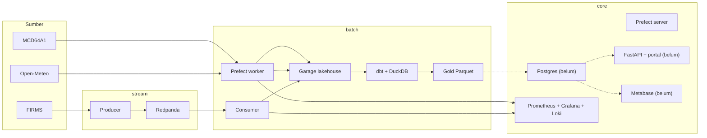

# Arsitektur

Status: **Bronze, Silver, dan Gold berjalan**; serving (Postgres + FastAPI), ML,
dan dashboard belum diimplementasikan.

## Tiga VM

| VM | Peran | Isi |
|---|---|---|
| `stream` | Near-stream ingestion | Redpanda, producer FIRMS |
| `batch` | Batch, lakehouse | Garage, consumer, Prefect worker, DuckDB + dbt |
| `core` | Serving, portal, observability | Postgres, Prefect server, FastAPI, portal, Metabase, Prometheus, Grafana, Loki, Caddy, Authelia |

Penyimpanan objek memakai **Garage** (S3-compatible), bucket `lakehouse`, bukan
MinIO. Format analitik **Parquet zstd**, transformasi **dbt + DuckDB**.

## Diagram

## Aliran data

1. Producer menarik FIRMS, menulis event ke Redpanda; consumer menulis Bronze
   JSONL ke Garage.
2. Prefect worker menarik Open-Meteo (harian) dan MCD64A1 (bulanan) ke Bronze.
3. Normalizer Python menulis Silver `_normalized`; dbt/DuckDB melakukan dedup,
   uji kualitas, dan menulis Silver final Parquet.
4. dbt membangun Gold Parquet dari Silver (`tag:gold`).
5. (Rencana) Gold disalin ke Postgres, lalu dibaca FastAPI dan Metabase.
6. (Rencana) Model ML membaca `cell_daily`, menulis `risk_prediction_daily`.

## Layer data

| Layer | Isi | Status |
|---|---|---|
| Bronze | JSON/JSONL/HDF + manifest + checksum, prefix `bronze/` | jalan |
| Silver | 6 tabel Parquet, dedup, DQ, karantina, prefix `silver/` | jalan |
| Gold | 3 tabel Parquet, prefix `gold/` | jalan |
| Serving | 3 mart Postgres + 10 endpoint | belum |

### Gold

| Tabel | Grain | Baris (Sep–Nov 2026) |
|---|---|---|
| `cell_daily` | `cell_id` × `date` (grid 0,25°) | 95.360 |
| `province_daily` | `province` × `date` | 1.216 |
| `burn_scar_monthly` | `burn_month` × `province` | 34 |
| `risk_prediction_daily` | `input_record_id` | menunggu ML |

Rekonsiliasi: total hotspot 486.238, tier kuat 45.869 / sedang 17.969 / lemah
11.531 / kandidat 410.869, scar 36.916 piksel ≈ 7.922 km². Semua diuji otomatis
di `dbt/tests/`.

Katalog dan lineage dihasilkan dari kontrak Gold: `catalog.json` memuat 4 tabel
(3 `implemented`, `risk_prediction_daily` masih `planned`) dengan owner,
klasifikasi, retensi, dan schema; `lineage.json` memuat 13 node dan 13 edge
Bronze → Silver → Gold.

Perintah: `task gold-build` (bangun + katalog), `task gold-test` (uji),
`task gold-catalog` (katalog saja), `task gold-check` (lint + unit test + build).

## Keputusan yang masih terbuka

- Table format Gold: Parquet sekarang, Iceberg v2 menyusul (ADR-02). Langkah
  publish Iceberg belum ada.
- Serving: Postgres, FastAPI, Metabase belum ada di Compose.
- ML: dataset, training, MLflow, dan inference belum dikerjakan.
- Batas resource per service: usulan ada di ADR-03, belum dipasang di Compose.
