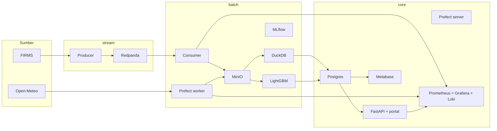

# Arsitektur

Status: skeleton.

## Tiga VM

| VM | Peran | Isi |
|---|---|---|
| `stream` | Near-stream ingestion | Redpanda, producer FIRMS |
| `batch` | Batch, lakehouse, ML | MinIO, consumer, Prefect worker, DuckDB, MLflow, LightGBM |
| `core` | Serving, portal, observability | Postgres, Prefect server, FastAPI, portal, Metabase, Prometheus, Grafana, Loki, Caddy, Authelia |

## Diagram

## Aliran data

1. Producer menarik FIRMS, menulis event ke Redpanda.
2. Consumer di `batch` membaca event, menulis Silver ke MinIO lokal.
3. Prefect worker menarik Open-Meteo, menulis Bronze, lalu DuckDB membangun Silver dan Gold.
4. Gold dikirim sebagai agregat ke Postgres di `core`.
5. LightGBM membaca Gold, menulis prediksi ke Postgres.
6. FastAPI, portal, dan Metabase membaca Postgres.
7. Prometheus, Grafana, dan Loki memonitor semua VM.

## Keputusan yang belum dibuat

- Table format: Delta Lake atau Iceberg.
- Partisi dan retensi.
- Skema event dan watermark.
- Mekanisme auth portal.
- Batas resource per service.
