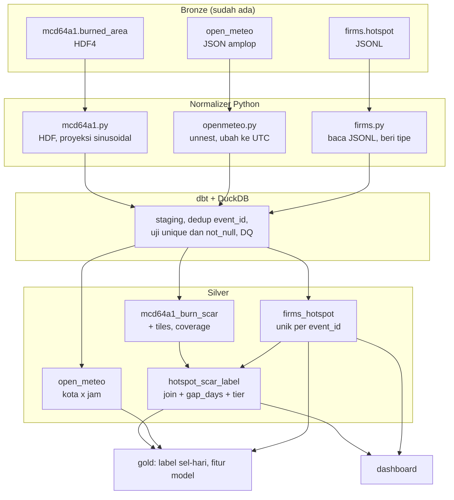

# Roadmap: Bronze ke Silver

Dokumen ini adalah pedoman kerja tahap Silver. Perbarui kolom status setiap kali
sebuah PR dibuka atau di-merge.

## Alur

## Urutan branch

Semua PR menuju `dev`. Nomor di depan adalah urutan merge.

| # | Branch | Pemilik | Base | Status |
|---|---|---|---|---|
| 0 | `fix/ci-dev` | Yuda | `dev` | merged |
| 1 | `chore/silver-foundation` | Aulia | `dev` | merged |
| 2 | `feat/silver-openmeteo` | Aulia | `dev` setelah 1 | merged |
| 3 | `feat/silver-firms` | Yuda | `dev` setelah 1 | merged |
| 4 | `feat/silver-mcd64a1` | Yuda | `dev`, boleh paralel | merged |
| 5 | `feat/silver-hotspot-label` | Yuda | `dev` setelah 2, 3, 4 | merged |
| 6 | `docs/contracts-silver` | Aulia | `dev` setelah 2 sampai 5 | lokal selesai, belum PR |
| 7 | `feat/silver-align` | Yuda | `dev` | merged |
| 8 | `chore/silver-ops` | Yuda | `dev` | merged |
| 9 | `feat/firms-backfill` | Yuda | `dev` | merged |
| 10 | `feat/openmeteo-backfill` | Yuda | `dev` | merged |
| 11 | `fix/silver-idempotent` | Yuda | `dev` | merged |

Branch `3` dan `4` boleh mulai sebelum `1` merge, asalkan stub tiga fungsi di
`src/batch/silver/` sudah disepakati. Yang ditunda hanya penyambungan ke writer
dan laporan DQ.

## Aturan kerja

- Satu PR untuk satu dataset atau satu tujuan. Jangan gabungkan dua dataset.
- CI harus hijau sebelum minta review.
- Penulis tidak me-review PR-nya sendiri. Pasangan review: Yuda dan Aulia.
- Jangan commit langsung ke `dev`. Selalu lewat PR.
- Setiap PR yang menyentuh requirement F-xx memperbarui `evidence/README.md`.

## Keputusan yang sudah dikunci

| Hal | Keputusan |
|---|---|
| Partisi Silver | waktu data, `date=YYYY-MM-DD` |
| Zona waktu | simpan `ts_utc`, pertahankan `ts_local` bila tersedia |
| Format | Parquet, kompresi zstd, nama kolom snake_case |
| Dedup | dilakukan di SQL (dbt), bukan di normalizer |
| Baris ditolak | masuk tabel karantina dengan alasan, tidak dibuang diam-diam |
| Duplikat Bronze | sah, diselesaikan di Silver per `event_id` |

## Definisi selesai per dataset

1. Jumlah baris cocok dengan Bronze; selisihnya dijelaskan di laporan DQ.
2. Menjalankan ulang menghasilkan isi yang sama.
3. Laporan DQ tertulis, termasuk jumlah baris yang dikarantina.
4. `dbt build` hijau, termasuk uji `unique` dan `not_null` pada kunci.
5. Kontrak di `docs/data-contracts/` terisi, bukan kerangka kosong.

## Perintah Silver

| Perintah | Fungsi |
|---|---|
| `task silver-openmeteo` | normalisasi Open-Meteo dari Bronze |
| `task silver-firms` | normalisasi FIRMS dari Bronze |
| `task silver-mcd64a1 -- 2026-09` | normalisasi MCD64A1 satu periode |
| `task silver-pull -- --month 2026-09` | turunkan parquet Garage ke folder lokal |
| `task dbt-build` | bangun tabel Silver lewat dbt |
| `task silver-push` | unggah hasil dbt ke Garage |
| `task silver-check` | lint, test, dan dbt build |

Tiga normalizer menulis ke Garage dan, secara default, juga menyalin hasilnya ke
`data/silver/_normalized/` supaya dbt bisa langsung membacanya.

Dua opsi berbeda untuk kasus khusus: `--no-mirror` pada FIRMS dan MCD64A1 berarti
hanya menulis ke Garage, sedangkan `--no-upload` pada Open-Meteo berarti hanya
menulis ke lokal.
