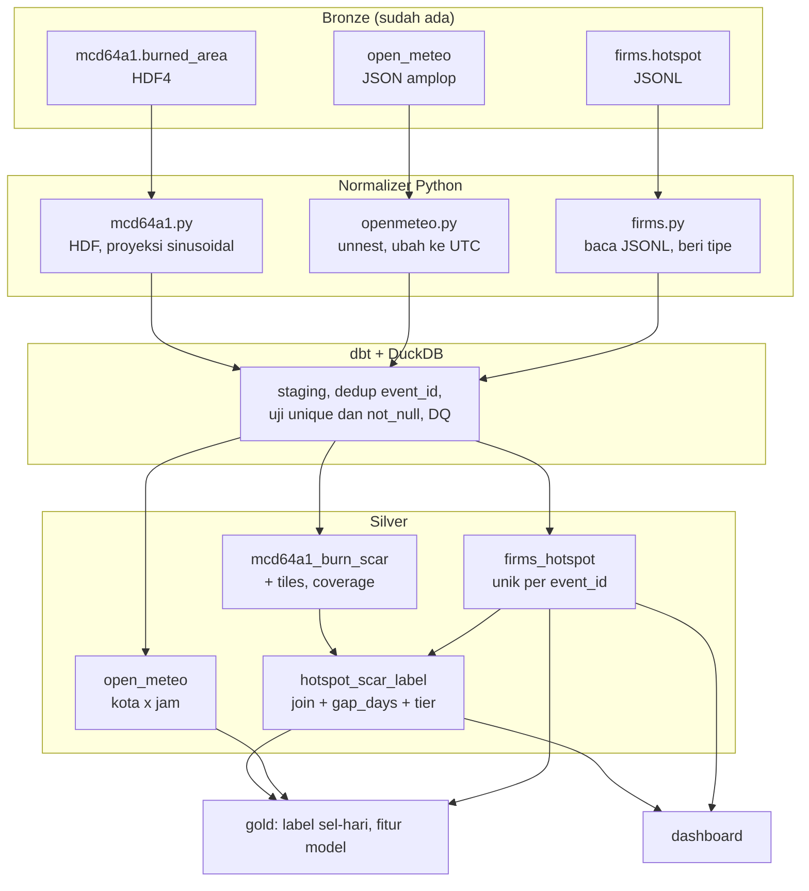

# Roadmap: Bronze ke Silver

Dokumen ini adalah pedoman kerja tahap Silver. Perbarui kolom status setiap kali
sebuah PR dibuka atau di-merge.

## Alur

## Urutan branch

Semua PR menuju `dev`. Nomor di depan adalah urutan merge.

| # | Branch | Pemilik | Base | Status |
|---|---|---|---|---|
| 0 | `fix/ci-dev` | Yuda | `dev` | PR dibuka, CI hijau |
| 1 | `chore/silver-foundation` | Aulia | `dev` | lokal selesai, belum PR |
| 2 | `feat/silver-openmeteo` | Aulia | `dev` setelah 1 | belum |
| 3 | `feat/silver-firms` | Yuda | `dev` setelah 1 | PR dibuka |
| 4 | `feat/silver-mcd64a1` | Yuda | `dev`, boleh paralel | belum |
| 5 | `feat/silver-hotspot-label` | Yuda | `dev` setelah 2, 3, 4 | belum |
| 6 | `docs/contracts-silver` | Aulia | `dev` setelah 2 sampai 5 | belum |

Branch `3` dan `4` boleh mulai sebelum `1` merge, asalkan stub tiga fungsi di
`src/batch/silver/` sudah disepakati. Yang ditunda hanya penyambungan ke writer
dan laporan DQ.

## Aturan kerja

- Satu PR untuk satu dataset atau satu tujuan. Jangan gabungkan dua dataset.
- CI harus hijau sebelum minta review.
- Penulis tidak me-review PR-nya sendiri. Pasangan review: Yuda dan Aulia.
- Jangan commit langsung ke `dev`. Selalu lewat PR.
- Setiap PR yang menyentuh requirement F-xx memperbarui `evidence/README.md`.

## Keputusan yang sudah dikunci

| Hal | Keputusan |
|---|---|
| Partisi Silver | waktu data, `date=YYYY-MM-DD` |
| Zona waktu | simpan `ts_utc`, pertahankan `ts_local` bila tersedia |
| Format | Parquet, kompresi zstd, nama kolom snake_case |
| Dedup | dilakukan di SQL (dbt), bukan di normalizer |
| Baris ditolak | masuk tabel karantina dengan alasan, tidak dibuang diam-diam |
| Duplikat Bronze | sah, diselesaikan di Silver per `event_id` |

## Definisi selesai per dataset

1. Jumlah baris cocok dengan Bronze; selisihnya dijelaskan di laporan DQ.
2. Menjalankan ulang menghasilkan isi yang sama.
3. Laporan DQ tertulis, termasuk jumlah baris yang dikarantina.
4. `dbt build` hijau, termasuk uji `unique` dan `not_null` pada kunci.
5. Kontrak di `docs/data-contracts/` terisi, bukan kerangka kosong.
